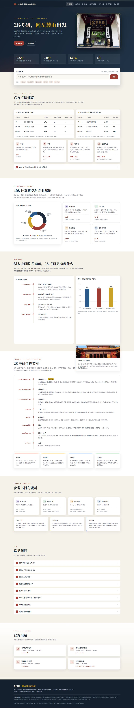

# Dusty · 作品集 Portfolio

> **武汉理工大学 · 航海技术（大二） | 软件测试实习 | 408 考研备考中**
>
> 英文名 Dusty，前端与数据分析爱好者，喜欢把「查资料、盯数据」这类事做成能看、能用的小工具。

---

## 项目一览

### 1. 湖南大学 408 考研信息站（`hnu-408/`）

面向 2028 考研、目标湖南大学计算机学院、专业课 408 统考的备考信息站：
**官方复试线、招生名额、408 科目、备考时间线、参考书目** 一站查询。

- 纯静态单文件 HTML，无构建、无依赖，打开即用
- 桌面 / 移动端自适应，深色导航 + 暖纸色阅读排版
- 适合考研人收藏为「信息总入口」



**技术栈**：原生 HTML / CSS / JavaScript ｜ 单文件交付

**查看**：打开 `hnu-408/28考研-湖南大学408信息站.html` 即可（或部署到任意静态托管）。

---

### 2. 王者荣耀返场投票监控台（`vote-dashboard/`）

王者荣耀周年庆「限定皮肤返场投票」的**实时票数抓取与排名看板**：
展示每款参选皮肤的名次、票数、与上一名的差距，并标出返场线。

- **在线看板**：<https://dusty-lwy.github.io/portfolio/vote-dashboard/>（手机电脑随时打开，无需电脑开机）
- 架构：GitHub Actions 每 10 分钟定时抓取 → `data/*.json` → GitHub Pages 静态看板
- 抓取器 `fetcher.py`：纯 Python 3 标准库零依赖，失败自动重试、超时兜底、票数无变化不提交
- 前端 `index.html`：ECharts 单文件看板（KPI、排行榜、趋势曲线），双 CDN 容错 + 每分钟自动刷新
- 活动参数（`iActivityId`/`iFlowId`/`g_tk`）写在 `数据源配置.json`，每期抓包后填入即可
- 提供 `--import` 手动导入兜底通道，抓不到包也能用

```
cd vote-dashboard
python fetcher.py --import "妲己 愿照·众生和 18910170"   # 手动导入一条快照
```

**技术栈**：Python 3 标准库 ｜ GitHub Actions ｜ GitHub Pages ｜ ECharts

---

## 联系方式

- GitHub：本仓库即是
- 微信 / 英文名：Dusty
